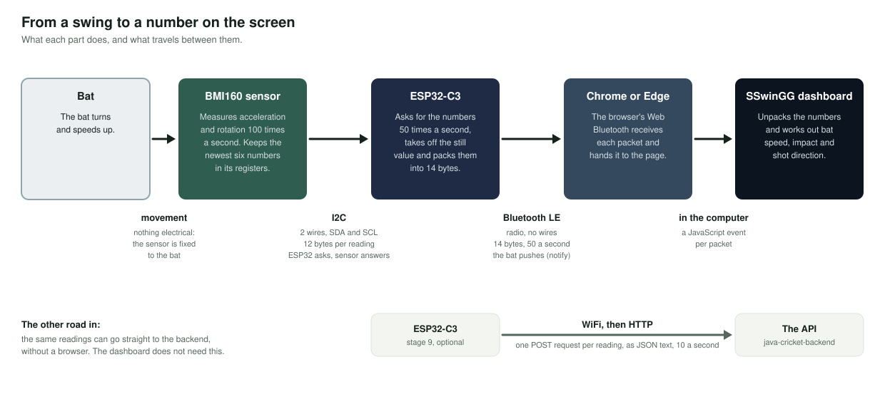
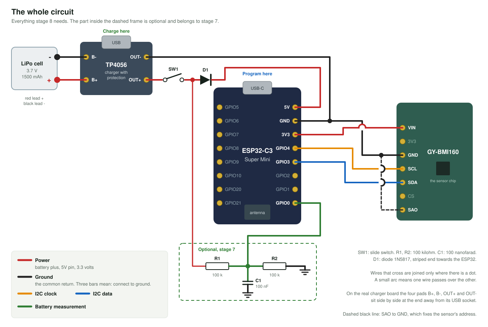

# SwingLab bat sensor: hardware and firmware, step by step

A small sensor that sits on a cricket bat and sends every movement of the bat to the SwingLab dashboard over Bluetooth. This folder holds the circuit, the firmware, and a guide that builds it one stage at a time, so that each stage is tested before the next part is added.

It is written for someone who has not done this before. Each stage says what to wire, what to upload, what you should see, and what is going on between the parts.



## What has been checked, and what has not

- **Checked:** every sketch compiles for the ESP32-C3 Super Mini, with no warnings. Stages 1 to 8 have also been run on a computer against a pretend sensor, battery and dashboard, and what they print, send and do with the light was checked there. The 14-byte Bluetooth packet was read back with the web app's own code.
- **Not checked:** nothing here has run on real hardware yet. The pin orders in the drawings come from published pinouts, not from your boards, and the battery circuit has not been built.

So follow the stages in order, and trust the labels printed on your own boards over any drawing.

## Parts

| Part | Notes |
|---|---|
| ESP32-C3 Super Mini | The small board with a USB-C socket and eight pins on each side. |
| GY-BMI160 | The motion sensor board: acceleration and rotation on three axes each. |
| LiPo cell, 3.7 V, 1500 mAh | One cell with two leads. Buy one with a built-in protection board, which is the usual kind. |
| TP4056 charger module **with protection** | The version with six pads: `IN+ IN- B+ B- OUT+ OUT-`. See [the question about the charger](#is-the-tp4056-the-right-charger). |
| Slide switch | Three pins in a row, 2.54 mm apart, for example the SS12D00. |
| Diode 1N5817 | A Schottky diode. A 1N5819 also works and loses a little more voltage. |
| Zero PCB | At least 20 by 16 holes. The common 5 by 7 cm board is big enough. |
| Female header strips | Two with 8 pins, one with 7. With them the two boards can be unplugged. |
| Insulated hook-up wire | Thin single-strand wire. |
| USB-C cable that carries data | Charge-only cables give no serial port. |
| Phone charger, 5 V and 1 A or more | To charge the cell through the TP4056. |
| Only for stage 7 | Two 100 kilohm resistors and one 100 nanofarad ceramic capacitor. |

Tools: a soldering iron and solder, a multimeter, wire cutters, insulating tape or heat-shrink tube, and double-sided foam tape for mounting.

**[docs/parts-to-buy.md](docs/parts-to-buy.md) is the shopping list:** the exact name to search for, how many, and what to check before paying.

## Before you touch the battery

A LiPo cell stores a lot of energy and can catch fire when it is mistreated.

- **Never let the red and the black lead touch.** Cut and solder them one at a time, never both together.
- **Check which lead is plus with a multimeter** before soldering. Red is normally plus, but plugs are wired both ways.
- **Charge it only through the TP4056**, on a surface that cannot burn, and not unattended.
- **Do not use a cell that is swollen, dented or punctured.**
- **Protect it on the bat.** Mount it away from where the ball hits, with foam under it.

## The stages

Do them in order. Each folder under [stages/](stages/) holds one sketch and a README with the steps.

| Stage | What you add | What you learn | It works when |
|---|---|---|---|
| [1. Blink](stages/01_blink/) | The ESP32 board and a USB cable | Uploading, the Serial Monitor, outputs and inputs | The light blinks and lines appear |
| [2. I2C scan](stages/02_i2c_scan/) | The sensor, on five wires | What I2C is, and addresses | It prints `RESULT: PASS` |
| [3. Read the sensor](stages/03_imu_read/) | Nothing | Registers, bytes, counts and units | Four checks pass and z reads 1 g |
| [4. Swing speed](stages/04_swing_speed/) | Nothing | Calibration, and the speed formula | A swing prints a speed |
| [5. Bluetooth](stages/05_ble_stream/) | Nothing | Advertising, connecting, notifications, the packet | The test page shows 50 readings a second |
| [6. Battery](stages/06_battery_power/) | Cell, charger, switch, diode | Where the power flows, charging, brownouts | It runs with no cable and counts no brownouts |
| [7. Battery level](stages/07_battery_level/) | Optional: two resistors, one capacitor | Measuring a voltage | The printed voltage matches a multimeter |
| [8. The bat firmware](stages/08_swinglab_bat/) | Nothing | How it all fits together | The dashboard records a shot |
| [9. WiFi](stages/09_wifi_to_api/) | Optional: nothing | WiFi, HTTP and JSON | The API lists the bat as online |

Stages 1 to 5 run from the USB cable. The battery comes in at stage 6, when everything else is known to work.

## The whole circuit



| From | To | What it carries | Added in |
|---|---|---|---|
| `3V3` | `VIN` of the sensor | Power for the sensor, 3.3 volts | Stage 2 |
| `GND` | `GND` of the sensor | Ground | Stage 2 |
| `GPIO4` | `SCL` | I2C clock | Stage 2 |
| `GPIO3` | `SDA` | I2C data | Stage 2 |
| `SAO` of the sensor | `GND` | Fixes the sensor's address at 0x68 | Stage 2 |
| Cell, red lead | `B+` of the charger | Battery plus | Stage 6 |
| Cell, black lead | `B-` of the charger | Battery minus | Stage 6 |
| `OUT+` of the charger | Switch, an end pin | Battery plus, protected | Stage 6 |
| Switch, middle pin | Diode, plain end | Battery plus, switched | Stage 6 |
| Diode, striped end | `5V` | Power into the ESP32 board | Stage 6 |
| `OUT-` of the charger | `GND` | Ground | Stage 6 |
| Switch, middle pin | R1 | Battery plus, switched | Stage 7 |
| `GPIO0` | middle of R1 and R2 | Half the battery voltage. C1 goes from here to ground. | Stage 7 |
| R2, other end | `GND` | Ground | Stage 7 |

Leave the sensor's `3V3`, `CS`, `INT1`, `INT2` and `OCS` pins unconnected.

More drawings:

- [What each pin of the ESP32 is used for](diagrams/pin-map.svg)
- [The sensor on five wires](diagrams/stage-2-sensor-wiring.svg)
- [Where the power flows](diagrams/stage-6-power.svg)
- [Measuring the battery](diagrams/stage-7-battery-sense.svg)
- [Zero PCB layout, hole by hole](diagrams/zero-pcb-layout.svg), with the steps in [docs/build-on-zero-pcb.md](docs/build-on-zero-pcb.md)

## Is the TP4056 the right charger?

Yes. The chip is called TP4056. There is no common charger called TP4050, so that is almost certainly the module you have.

- **What it does.** It charges one LiPo cell from 5 volts. It holds the current steady until the cell reaches 4.2 volts, then holds 4.2 volts until the current has dropped to a tenth, and then stops.
- **Get the version with protection.** It has six pads instead of four, and two extra small chips. They disconnect the cell when it is drained below about 2.4 volts, charged above about 4.3 volts, or shorted.
- **The charging current is 1 amp as sold.** That suits a 1500 mAh cell: cells are normally charged at up to their capacity per hour, which here is 1.5 amps. A full charge takes about two hours. To charge more gently, see [docs/make-changes.md](docs/make-changes.md#charge-more-slowly-or-use-another-cell).
- **The ESP32-C3 Super Mini has no charger of its own**, which is why this module is needed.
- **It is not a switch and not a regulator.** The slide switch turns the bat off. The regulator on the ESP32 board makes the 3.3 volts.

## Set up the Arduino IDE

1. **Install the Arduino IDE**, version 2, from arduino.cc.
2. **Add the ESP32 boards:** Tools > Board > Boards Manager, search for `esp32`, and install "esp32 by Espressif Systems". This kit was compiled with version 3.3.11.
3. **Choose the board:** Tools > Board > esp32 > **Nologo ESP32C3 Super Mini**.
4. **Choose the port:** Tools > Port, the one that appears when the board is plugged in. On a Mac its name starts with `/dev/cu.usbmodem`.
5. **Open a sketch** with File > Open and pick the `.ino` file inside a stage folder.
6. **Upload**, then open Tools > Serial Monitor and set it to **115200** baud.

No library has to be installed. Everything the sketches need is in their own folders.

If an upload cannot connect: hold the BOOT button, press and release RESET, release BOOT, and upload again. Press RESET once afterwards to start the sketch.

## How it works, and how to change it

- [docs/parts-to-buy.md](docs/parts-to-buy.md) is the shopping list.
- [docs/how-it-works.md](docs/how-it-works.md) explains the whole chain: what the sensor measures, the I2C conversation, the packet, Bluetooth, the arithmetic of the dashboard, and the power circuit.
- [docs/make-changes.md](docs/make-changes.md) says what else has to change when you change a pin, a part, the name, the rate or the battery.
- [docs/build-on-zero-pcb.md](docs/build-on-zero-pcb.md) is the soldering guide.
- [docs/troubleshooting.md](docs/troubleshooting.md) lists what can go wrong, by what you see.

## What is in this folder

| Path | What it is |
|---|---|
| `stages/01_blink` to `stages/09_wifi_to_api` | One Arduino sketch per stage, each with its own README. |
| `stages/08_swinglab_bat/` | The firmware that stays on the bat. Its settings are in `config.h`. |
| `stages/*/bmi160.h` | The sensor driver. The same file in three folders, because the Arduino IDE only compiles files inside a sketch's own folder. |
| `stages/*/swing_packet.h` | Builds the 14-byte packet. This is the agreement with the web app. |
| `stages/*/battery.h` | Battery voltage to percent. |
| `diagrams/` | Every drawing as SVG, and `make_diagrams.py`, which draws them. |
| `docs/` | The five guides listed above. |
| `tools/ble_test.html` | A page that connects to the bat from a browser and shows what it sends. |
| `tools/check.mjs` | Checks the whole kit without hardware. |
| `tools/sim/` | The simulator that `check.mjs` uses to run the sketches on a computer. |

## Check the kit without hardware

After changing a sketch, a pin or a drawing, run:

```bash
node tools/check.mjs            # under a minute
node tools/check.mjs --board    # also compiles every sketch for the ESP32-C3, several minutes
```

It needs Node 22 or newer and a C++ compiler. It confirms that the copies of the shared files are identical, that every sketch, the drawings and this README use the same pins, that the packet is what the web app expects, and that every sketch behaves as its stage describes when run in the simulator. It cannot check soldering, radio range or a real battery.

You can also run a single sketch in the simulator and watch what it prints:

```bash
tools/sim/run.sh stages/04_swing_speed "swing@3000:400:900:1,end@6000"
```

The words of the scenario are listed at the top of [tools/sim/sim_main.cpp](tools/sim/sim_main.cpp).

## Using it with the dashboard

1. Open the SwingLab dashboard in Chrome or Edge and sign in. The web app is in the [Cric-Pro-FE](https://github.com/gaurav3611/Cric-Pro-FE) repository.
2. Switch the bat on and wait for the slow blink.
3. Press **Connect Sensor** and choose `SwingLab-Bat`.
4. Press **START SHOT**, swing, then press **STOP & SAVE SHOT**. The dashboard reads the sensor only between those two presses.

Only one program can be connected to the bat at a time. Close the test page first.
