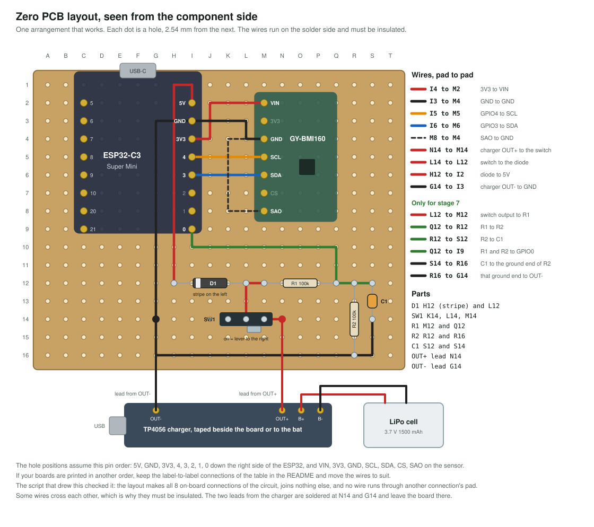

# Build it on the zero PCB

On a zero PCB every hole is a separate pad. Nothing is joined until you join it with solder or wire. The drawing shows one arrangement that works, seen from the side the parts sit on. The wires run on the other side, pad to pad.

The script that drew the layout also checked it: it makes every connection of the circuit, joins nothing else, and no wire runs through the pad of another connection. That does not make your soldering right. The multimeter checks below do.

You do not have to solder everything at once. Build in three sessions, and test after each.

## Session 1: before stage 2

The two boards and the five sensor wires.

1. **Solder the pin strips to the two boards** if they came loose, pins pointing down. Push the strips into a breadboard or the female headers first, lay the board on top, and solder. That keeps the pins straight.
2. **Place the female headers.** For the ESP32: two 8-pin strips in columns C and I, rows 2 to 9. For the sensor: one 7-pin strip in column M, rows 2 to 8. The USB-C end of the ESP32 points to the edge of the board, so the cable can reach it.
3. **Plug both boards in before soldering anything**, to check the fit.
4. **Solder every header pin** on the underside.
5. **Add the five wires** on the underside:

   | From | To | Colour in the drawing | Connects |
   |---|---|---|---|
   | I4 | M2 | red | `3V3` to `VIN` |
   | I3 | M4 | black | `GND` to `GND` |
   | I5 | M5 | orange | `GPIO4` to `SCL` |
   | I6 | M6 | blue | `GPIO3` to `SDA` |
   | M8 | M4 | black, dashed | `SAO` to `GND` |

6. **Check with the multimeter before plugging in USB.** Set it to continuity, the setting that beeps.
   - It must beep between the two ends of each wire in the table.
   - It must not beep between `3V3` and `GND`. If it does, there is a short. Find it before any power is connected.
   - It must not beep between `SCL` and `SDA`, or between any pad and its neighbour.

Now do stages 2 to 5.

## Session 2: before stage 6

The switch, the diode and the two leads from the charger. Read [the README of stage 6](../stages/06_battery_power/) first: it has the checks that keep the battery safe.

| Part | Holes | Notes |
|---|---|---|
| D1, the diode | H12 and L12 | **The striped end goes in H12.** That end leads to the `5V` pin. |
| SW1, the switch | K14, L14, M14 | The middle pin is L14. |
| Lead from the charger's `OUT+` | N14 | Red wire. |
| Lead from the charger's `OUT-` | G14 | Black wire. |

| From | To | Colour | Connects |
|---|---|---|---|
| N14 | M14 | red | `OUT+` to the switch |
| L14 | L12 | red | switch to the diode |
| H12 | I2 | red | diode to `5V`. The wire runs up under the ESP32 and round the top of its header. |
| G14 | I3 | black | `OUT-` to `GND`. This one also runs under the ESP32. |

The charger module does not fit the holes of the zero PCB. Fix it beside the board, or to the bat, with foam tape, and keep its USB socket reachable.

## Session 3, optional: before stage 7

| Part | Holes |
|---|---|
| R1, 100 kilohm | M12 and Q12 |
| R2, 100 kilohm | R12 and R16 |
| C1, 100 nanofarad | S12 and S14 |

| From | To | Colour | Connects |
|---|---|---|---|
| L12 | M12 | red | switch output to R1 |
| Q12 | R12 | green | R1 to R2 |
| R12 | S12 | green | R2 to C1 |
| Q12 | I9 | green | the middle point to `GPIO0` |
| S14 | R16 | black | C1 to the ground end of R2 |
| R16 | G14 | black | that ground end to `OUT-` |

## If your boards are printed differently

The hole positions assume this pin order: `5V, GND, 3V3, 4, 3, 2, 1, 0` down the right side of the ESP32 with its USB socket up, and `VIN, 3V3, GND, SCL, SDA, CS, SAO` on the sensor. Boards from different makers differ. If yours do, keep the label-to-label connections of the table in the [README](../README.md#the-whole-circuit) and move the wires to suit.

## Good habits

- **Insulated wire only.** Several wires cross on the underside.
- **Short wires for power and ground.** Long thin wires to the battery are the usual cause of restarts during a swing.
- **Clean joints.** A good joint is shiny and shaped like a small cone. A dull ball sitting on the pad is not connected.
- **Look for bridges.** Hold the board against a light. Solder that joins two neighbouring pads shows up at once.
- **Cover the underside** with tape or a piece of foam when everything works, so nothing metal can touch it on the bat.
