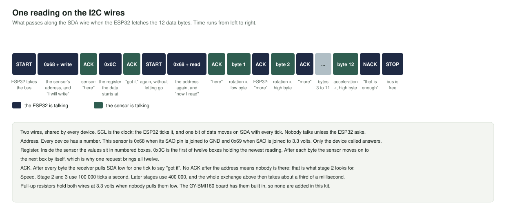
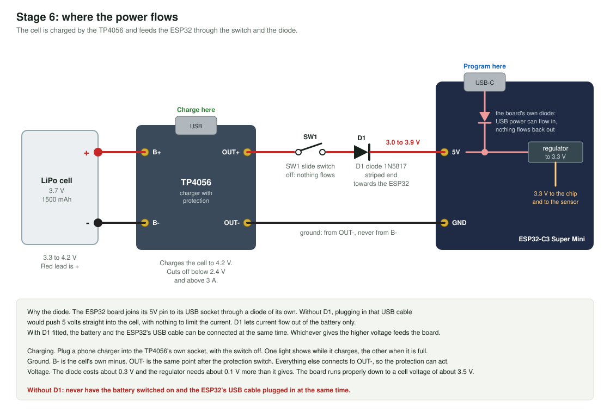

# How it works

This page follows one swing from the bat to the screen, and then the power from the cell to the chip. Each part names the stage where you can see it happen.


## 1. What the sensor measures

The GY-BMI160 board carries one chip, the Bosch BMI160. It holds two sensors.

- **The accelerometer** measures push, in g. One g is the pull of gravity. A board lying still on a table reads 1 g straight up through whichever axis points up, and 0 on the other two. That is how stage 3 checks it.
- **The gyroscope** measures how fast the board is turning, in degrees per second. A board lying still reads close to 0 on all three axes. Never exactly 0: every chip is a little off, and stage 4 deals with that.

Each sensor has three axes, x, y and z, printed as arrows on the board. So one reading is six numbers.

The chip takes a new reading 100 times a second on its own and keeps the newest one. It does not send anything by itself. Somebody has to ask.

Both sensors have a range, which this kit sets and must not change without changing the web app:

| | Range set by this kit | What happens beyond it |
|---|---|---|
| Acceleration | 8 g either way, on each axis | The number stops at the limit. The peak is cut off. |
| Rotation | 2000 degrees per second either way, on each axis | The same. |

## 2. Sensor to ESP32: I2C



I2C is a way for chips on the same board to talk over two wires.

- **SCL** is the clock. The ESP32 ticks it.
- **SDA** is the data. One bit moves with every tick, in either direction.
- **Every device has an address.** The ESP32 starts each exchange by calling one. This sensor is 0x68 when its `SAO` pin is joined to ground. Stage 2 calls every address and lists who answers.
- **The sensor is a set of numbered boxes, called registers.** To set the sensor up, the ESP32 writes a value into a register. To measure, it reads registers.

The registers this kit uses:

| Register | Name | What the kit does with it |
|---|---|---|
| 0x00 | chip id | Reads it. A BMI160 always says 0xD1. |
| 0x03 | power status | Reads it. 0x14 means both sensors are awake. |
| 0x0C to 0x17 | data | Reads these 12 bytes in one go: rotation x, y, z, then acceleration x, y, z. |
| 0x20, 0x21 | temperature | Reads it once a second. |
| 0x40, 0x42 | rate | Writes 0x28 to each: 100 readings a second. |
| 0x41 | acceleration range | Writes 0x08: 8 g. |
| 0x43 | rotation range | Writes 0x00: 2000 degrees per second. |
| 0x7E | command | Writes 0xB6 to reset, 0x11 to wake the accelerometer, 0x15 to wake the gyroscope. |

Stage 3 prints every one of these writes as it makes them.

## 3. From bytes to numbers

Each of the six values arrives as two bytes, **low byte first**. Together they are one number from -32768 to +32767, called counts.

```
bytes 12 10   ->   0x1012   ->   4114 counts   ->   4114 / 4096   =   1.004 g
```

The divisor comes from the range. At 8 g, the full 32768 counts mean 8 g, so 1 g is 4096 counts. At 2000 degrees per second, one degree per second is 16.4 counts.

## 4. The still position

A gyroscope at rest reports a small steady rotation, for example +0.3 degrees per second. Left in, a still bat would show a small speed.

So at power-on the firmware asks you to keep the bat still for a second, averages 100 readings, and subtracts that average from every later reading. If the bat moved during that second, it notices and tries again. Holding the BOOT button for a second repeats it.

## 5. The packet


The ESP32 packs the six numbers, plus the temperature, into 14 bytes: seven 16-bit numbers, low byte first, in the order ax, ay, az, gx, gy, gz, temperature. They stay as counts. The web app divides by 4096 and 16.4.

This layout is the one agreement between the bat and the web app. It lives in `swing_packet.h` on this side and in `sensor-packet.ts` of the web app on the other. `tools/check.mjs` builds packets with the first and reads them with the second.

Two things happen on the way into the packet:

- **The still value is subtracted** from the three rotation numbers.
- **The axes can be turned.** If the board sits on the bat in a different direction than the dashboard expects, `AXIS_SOURCE` and `AXIS_SIGN` in `config.h` choose which sensor axis feeds which value, and flip signs.

## 6. ESP32 to browser: Bluetooth Low Energy


- **The bat is the peripheral.** It holds data and waits. The browser is the central. It looks for devices and connects.
- **Advertising.** Until someone connects, the bat broadcasts its name and the id of its service a few times a second. A device that is not advertising cannot be found.
- **Service and characteristic.** The data inside a device is organised like folders and files. The bat has one service with one characteristic in it, the 14-byte reading. Each is named by a long id, and the browser asks for exactly those ids.
- **Notify.** Reading a value means asking for it. Notify means the device pushes every new value by itself, once the browser has switched that on. The bat pushes 50 a second.
- **One notification carries up to 20 bytes** on every Bluetooth Low Energy connection, without any negotiation. The packet is 14, so one reading is always one notification.
- **Web Bluetooth** is the part of Chrome and Edge that lets a web page do all this. It works only on `https` pages or on `localhost`, and only after you pick the device yourself.

Only one central can be connected at a time. While the test page is connected, the dashboard cannot find the bat.

## 7. What the dashboard works out

From each packet:

```
total rotation = square root of (gx squared + gy squared + gz squared)    degrees per second
if it is below 5, it counts as 0                                          the dead zone
bat speed      = total rotation x pi / 180 x 0.85 x 3.6                   km/h, never more than 180
impact         = square root of (ax squared + ay squared + az squared)    g
direction      = leg side if gz is above +1, off side if below -1, otherwise straight
```

The 0.85 is the distance in metres from the wrists to the sweet spot of the bat. A point that far from the pivot moves 0.85 metres for every radian the bat turns. Stage 4 does the same sum on the board, so you can compare.

The dashboard uses packets only between **START SHOT** and **STOP & SAVE SHOT**. For a shot it keeps the highest speed and the highest impact, and takes the direction from the last packet before STOP.

### Limits you will run into

These follow from the ranges and from how the dashboard scores. They are not faults in your build.

- **Speed tops out near 107 km/h for a swing around one axis.** 2000 degrees per second is 106.8 km/h. Harder swings read flat at the limit. Stage 4 tells you when that happens.
- **Impact tops out at 13.9 g.** That is 8 g on all three axes at once. The moment of ball contact is far sharper and is cut off.
- **Two of the dashboard's grades cannot be reached**, because they need more than 15 g and more than 20 g.
- **The control score is 0 on a real swing.** The dashboard computes it as 100 minus 20 times the spread of gy in degrees per second, and a swing spreads gy by hundreds.

## 8. Power



- **The cell** gives 4.2 volts when full and falls to about 3.4 volts when nearly empty. Most of its charge is delivered between 4.1 and 3.6 volts.
- **The TP4056 charges it.** From its own USB socket it pushes a steady 1 amp until the cell reaches 4.2 volts, then holds 4.2 volts while the current falls, and stops at 0.1 amp. One light is on while it charges, the other when it is done.
- **Its protection chips guard the cell.** They disconnect it below about 2.4 volts, above about 4.3 volts, and at about 3 amps. They sit in the minus wire, between `B-` and `OUT-`. That is why everything else must use `OUT-` as its ground and never `B-`.
- **The switch** opens the plus wire. Off means nothing flows, and the cell can still be charged.
- **The diode** lets current flow from the battery to the ESP32 and not back. It costs about 0.3 volts.
- **The regulator on the ESP32 board** turns whatever arrives at the `5V` pin into 3.3 volts for the chip and for the sensor. It needs its input a little above 3.3 volts. With the diode in the way, the board runs properly down to a cell voltage of about 3.5 volts, and that is where the firmware calls the battery empty.

### Why the diode matters

The ESP32 board joins its `5V` pin to its USB socket through a diode of its own, so USB power can come in. Without D1, the cell would sit directly on that same line. Plug in the USB cable and 5 volts would be pushed into the cell with nothing to limit the current. That is how LiPo cells are damaged.

With D1, each source has its own diode. Both can be connected, and the one with the higher voltage feeds the board. You can leave the battery on while you upload a sketch.

### Brownouts

When the radio sends, the chip draws a few hundred milliamps for a moment. If the wires to the battery are thin or long, or a joint is poor, the voltage at the chip dips for that moment. When it dips too far, the chip restarts itself. That is a brownout. Stage 6 counts them, and the count must stay at 0.

### How long the battery lasts

```
hours = capacity in mAh x 0.85 / average current in mA
```

The sensor and the chip with Bluetooth active draw somewhere between 40 and 80 mA. That figure is from typical values for this chip, not from a measurement on this build. With 1500 mAh it gives between 16 and 32 hours. To find your own number, charge fully, let stage 6 run until it stops, and read "Previous run" on the next start.

### Measuring the battery, stage 7


A GPIO pin can measure a voltage up to about 2.5 volts. A full cell is 4.2. Two equal resistors in a row halve it, and the firmware doubles the result. The resistors are joined after the switch, so they draw nothing when the bat is off.

The firmware turns the voltage into a rough percentage with a small table in `battery.h`, sends it over Bluetooth as the standard battery value, blinks three times when it is low, and goes to sleep when it is empty.

## 9. The light

| Light | Meaning |
|---|---|
| Fast blinking | Measuring the still position. Keep the bat still. |
| Slow blinking | Waiting for a connection. |
| Steady on | Connected and sending. |
| Two quick blinks, pause | Sensor not found. Check the wiring. |
| Three quick blinks, pause | Battery low. Needs the stage 7 parts. |
| Five quick blinks, then off | Battery empty. The bat sleeps until switched off and on. |

## 10. What the firmware does, in order

At power-on, [the stage 8 sketch](../stages/08_swinglab_bat/08_swinglab_bat.ino):

1. Reads the battery, if it can, and sleeps at once if the cell is empty.
2. Finds and wakes the sensor. Retries until it answers.
3. Measures the still position.
4. Starts Bluetooth and begins advertising.

Then, round and round:

- **Every 20 milliseconds** it reads the sensor and builds a packet. If a dashboard is connected, it sends it.
- **Every second** it checks the battery, prints one line to the Serial Monitor, and restarts the sensor if it has stopped answering.
- **All the time** it sets the light, watches the BOOT button, and starts advertising again after a disconnect.

## 11. The other road: WiFi

The same chip also has a WiFi radio. [Stage 9](../stages/09_wifi_to_api/) uses it to send readings straight to the backend as text, one HTTP request per reading. The dashboard does not need this. It is the way readings can reach the backend without a browser, and it shows the difference between packing numbers into 14 bytes and sending them as about 110 characters of JSON.
