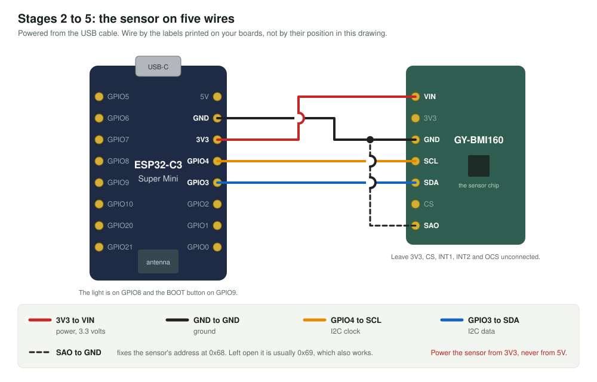

# Stage 2: can the board see the sensor?

**You add:** the GY-BMI160 sensor, on five wires.

**You learn:** what I2C is, and that every device on it has an address.



| ESP32-C3 pin | Sensor pin | Purpose |
|---|---|---|
| `3V3` | `VIN` | Power, 3.3 volts |
| `GND` | `GND` | Ground |
| `GPIO4` | `SCL` | I2C clock |
| `GPIO3` | `SDA` | I2C data |
| `GND` | `SAO` | Fixes the sensor's address at 0x68 |

Leave the sensor's `3V3`, `CS`, `INT1`, `INT2` and `OCS` pins unconnected.

## Steps

1. **Unplug the USB cable.** Never wire with power on.
2. **Make the five connections.** On the zero PCB, follow session 1 of [build-on-zero-pcb.md](../../docs/build-on-zero-pcb.md). On a breadboard, use five jumper wires.
3. **Check with the multimeter** that `3V3` and `GND` are not joined.
4. Plug in, open [02_i2c_scan.ino](02_i2c_scan.ino), upload, and open the Serial Monitor.

## What you should see

Every three seconds:

```
===== Stage 2: I2C scan =====
SDA = GPIO3, SCL = GPIO4

Scanning addresses 0x01 to 0x7E...
  0x68 answered   chip id 0xD1: this is the BMI160
RESULT: PASS. The sensor is wired correctly. Go on to stage 3.
```

**The stage is passed when** it prints `RESULT: PASS`.

With a wire missing, it says what to check instead:

```
Scanning addresses 0x01 to 0x7E...
RESULT: FAIL. Nobody answered. Check, in this order:
  1. Sensor VIN goes to 3V3 and sensor GND goes to GND.
  2. Sensor SDA goes to GPIO3 and SCL to GPIO4. They are easy to swap.
  3. Every solder joint is shiny, and no two neighbouring pads touch.
  4. Still nothing? Connect the sensor's CS pin to 3V3. That forces it into I2C mode.
```

It keeps scanning, so you can fix a wire and watch it pass without uploading again.

## What is going on

- **I2C is two shared wires.** SCL carries a clock that the ESP32 ticks. SDA carries the data, one bit per tick. Many devices can hang on the same two wires.
- **Every device has an address.** The ESP32 starts each exchange by sending one. The device with that address answers "here", and all others stay quiet. The sketch simply tries all 126 possible addresses.
- **`SAO` chooses between two addresses**, 0x68 and 0x69, so that two of these sensors could share the wires.
- **The chip id.** A sensor is a set of numbered boxes called registers. Box 0x00 of a BMI160 always holds 0xD1. Reading it proves that the device at 0x68 really is the sensor we expect.
- **Why 3.3 volts.** The ESP32's pins work at 3.3 volts. Powering the sensor from the same 3.3 volts keeps both ends at the same level.

The full conversation is drawn in [how-it-works.md](../../docs/how-it-works.md#2-sensor-to-esp32-i2c).

## Try this

- Pull the `SAO` wire off. The address usually changes to 0x69, and the stage still passes.
- Pull the `SDA` wire off. Nobody answers.

## If it does not work

See [The sensor](../../docs/troubleshooting.md#the-sensor-stages-2-to-4).

Next: [stage 3](../03_imu_read/).
