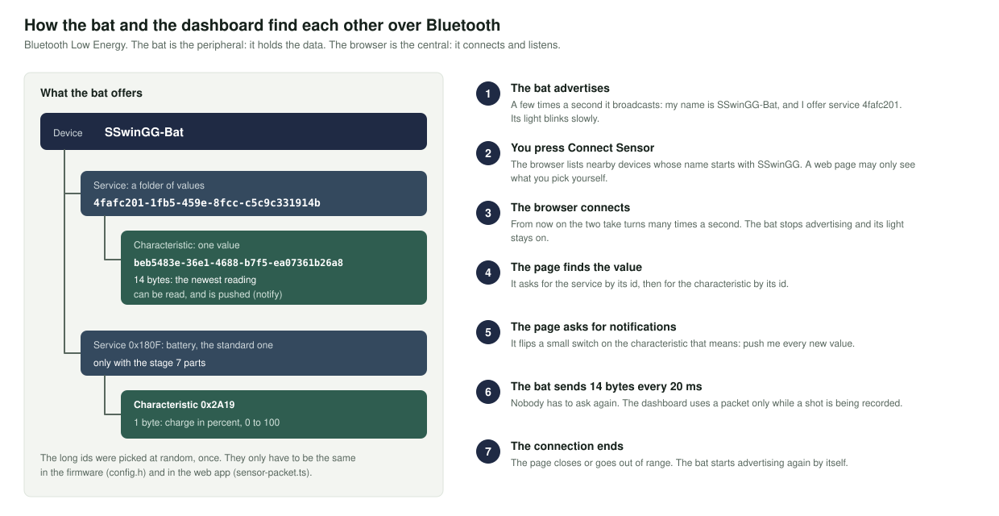
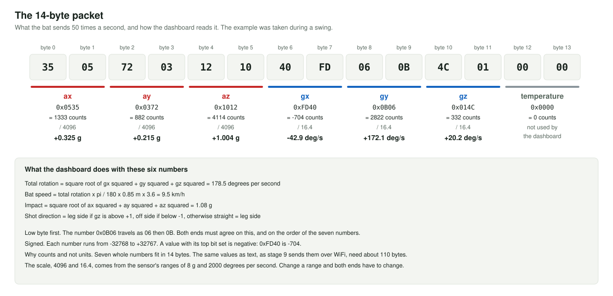

# Stage 5: send the readings over Bluetooth

**You add:** nothing. Still on the USB cable.

**You learn:** how a Bluetooth Low Energy device is found, connected to and listened to, and what the 14-byte packet looks like.



## Steps

1. Lay the board still. Open [05_ble_stream.ino](05_ble_stream.ino) and upload. The light blinks slowly: it is waiting for a connection.
2. On the computer, serve the test page. It has to come from `localhost`, because browsers block Bluetooth for pages opened as files. In a terminal, from this kit's folder:

   ```bash
   cd tools
   python3 -m http.server 8000
   ```

3. Open `http://localhost:8000/ble_test.html` in **Chrome or Edge**.
4. Press **Connect to the bat** and choose `SwingLab-Bat`.
5. Swing the board.

No computer nearby? The phone app nRF Connect also works: scan, connect to `SwingLab-Bat`, open the service, and switch notifications on for its one value.

## What you should see

On the board, the light goes steady. In the Serial Monitor:

```
===== Stage 5: Bluetooth stream =====
BMI160 found at 0x68
Keep the board still for one second...
Bluetooth is on. Look for "SwingLab-Bat".
waiting    sent 0/s  failed reads 0  last packet: 2F 00 AB FF 0E 10 01 00 00 00 00 00 00 00
connected  sent 12/s  failed reads 0  last packet: 32 00 AF FF 13 10 00 00 FF FF 01 00 00 00
connected  sent 50/s  failed reads 0  last packet: 35 05 72 03 12 10 40 FD 06 0B 4C 01 00 00
connected  sent 50/s  failed reads 0  last packet: 2F 00 AB FF 0E 10 02 00 01 00 01 00 00 00
Disconnected. Advertising again.
waiting    sent 13/s  failed reads 0  last packet: 34 00 AF FF 11 10 02 00 00 00 01 00 00 00
```

On the test page:

- about 50 readings per second
- all four checks pass while the board lies still
- the table "The last packet, taken apart" shows the same bytes as the Serial Monitor, split into seven numbers
- a swing makes the bat speed rise and the chart draw a peak

**The stage is passed when** the page shows 50 readings a second and a speed of 0 at rest.

"Try with a simulated bat" on the page shows what a working connection looks like, with numbers the page makes up itself.

## What is going on



- **Advertising.** `BLEDevice::startAdvertising()` makes the board broadcast its name and the id of its service a few times a second.
- **Server, service, characteristic.** The board holds the data, so it is the server. The sketch creates one service, a folder, and in it one characteristic, a value. Both are named by a long id that the dashboard asks for by heart.
- **Notify.** Every 20 milliseconds the sketch puts a new 14-byte value into the characteristic and calls `notify()`. The connected browser receives it without asking.
- **The packet.** Seven 16-bit numbers, low byte first: ax, ay, az, gx, gy, gz, temperature. `swing_packet.h` builds it. The browser divides the first three by 4096 and the next three by 16.4.
- **Callbacks.** `onConnect` and `onDisconnect` are called by the Bluetooth code when someone arrives or leaves. They only set a flag, and `loop()` acts on it.
- **Two radios, one chip.** Bluetooth is built into the ESP32-C3. No part was added for this stage.

## Try this

- Compare the "last packet" line in the Serial Monitor with the table on the test page. Work one value out by hand.
- Change `SAMPLE_PERIOD_MS` to `100` and upload. The page now shows 10 readings a second and its first check fails. Put it back to 20.
- Close the test page. The board prints "Disconnected. Advertising again." and the light blinks again.

## If it does not work

See [Bluetooth](../../docs/troubleshooting.md#bluetooth-stages-5-and-8).

Next: [stage 6](../06_battery_power/).
