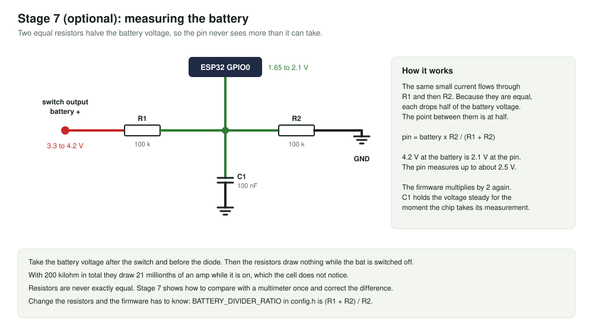

# Stage 7, optional: measure the battery

**You add:** two 100 kilohm resistors and one 100 nanofarad capacitor.

**You learn:** how a chip measures a voltage, and why the measurement has to be compared with a multimeter once.

Skip this stage if you do not need a battery reading. The bat works without it.



## Steps

1. Switch the battery off and unplug USB.
2. Solder R1, R2 and C1 as in session 3 of [build-on-zero-pcb.md](../../docs/build-on-zero-pcb.md).
3. **Check with the multimeter, battery switched on:** the point between R1 and R2 must read half the cell voltage, so between 1.65 and 2.1 volts. If it reads the full cell voltage, R2 is not joined to ground. Do not go on until this is right: a GPIO pin must never see more than 3.3 volts.
4. Upload [07_battery_level.ino](07_battery_level.ino) and open the Serial Monitor, with the battery switched on.
5. Measure the cell with the multimeter, from the charger's `OUT+` to `OUT-`, and compare.

## What you should see

```
===== Stage 7: battery level =====
Measuring on GPIO0. Divider ratio 2.0, calibration 1.000
Switch the battery on. Compare the volts below with a multimeter on the battery.

pin    3 mV   no battery seen. Is the switch on, and are R1 and R2 fitted?
pin 2060 mV   battery 4.12 V    92%   ok
pin 1780 mV   battery 3.56 V     8%   low: charge soon
pin 1705 mV   battery 3.41 V     0%   EMPTY: switch off and charge
```

The four lines show the four states. On your board you will see one of them, and it changes only as the cell drains.

**The stage is passed when** the printed voltage is within 0.05 volts of the multimeter.

## Calibrate

Resistors are never exactly equal, so the printed voltage is usually a little off.

```
CALIBRATION = multimeter volts / printed volts
```

For example, 4.08 on the multimeter and 4.00 printed gives 1.020. Put that number in the sketch, upload, and check that the two now agree. Write it down: stage 8 needs the same number.

## What is going on

- **An ADC** turns a voltage into a number. On this chip GPIO0 to GPIO4 can do that, up to about 2.5 volts.
- **The two resistors** halve the battery voltage, so 4.2 volts becomes 2.1. The sketch multiplies by 2 again.
- **The capacitor** keeps the middle point steady for the instant the chip measures.
- **Averaging.** The sketch takes 32 measurements and averages them, because one alone is noisy.
- **Percent is a rough guide.** The voltage of a LiPo cell does not fall in a straight line, so `battery.h` looks it up in a small table. The voltage also dips while the radio sends.
- **Where the wire is taken from.** After the switch, so the resistors draw nothing when the bat is off. Before the diode, so it is the cell's own voltage.

## Try this

- Watch the voltage for a minute with Bluetooth off. Then compare with stage 8 running: it reads slightly lower under load.
- Switch the battery off while the USB cable keeps the board running. The sketch says "no battery seen".

## If it does not work

See [The battery](../../docs/troubleshooting.md#the-battery-stages-6-and-7).

Next: [stage 8](../08_swinglab_bat/).
